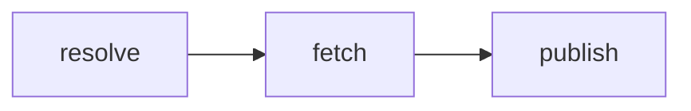
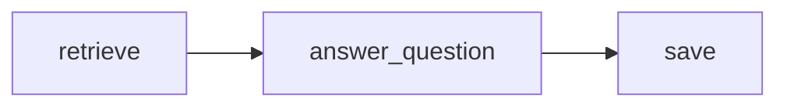

# Technical reference

## Import and snapshot lifecycle

FastAPI serves Jinja views and accepts forms from the local workspace. The
import service owns a small worker pool. A submitted repository becomes a job
before the request returns. Repeated active submissions share the job ID.
LangGraph passes a job ID and, once available, the resolved repository head
between three nodes. [Import implementation](https://github.com/ThibaultLeveau/repo_analyzer/blob/main/src/repopilot/imports.py)
and [LangGraph Graph API](https://docs.langchain.com/oss/python/langgraph/graph-api).

1. **resolve** obtains the canonical repository, default branch and full SHA from
   GitHub, or reuses the job's pinned source.
2. **fetch** downloads the archive for that SHA on a cache miss. The snapshot
   loader validates entries and limits, indexes allowed text in a temporary
   directory and publishes the finished snapshot atomically.
3. **publish** records the completed commit. A refresh prepares the compatible
   analysis artifacts and previously requested features before switching the
   active commit. Earlier snapshots remain addressable.

The job can move from queued to running to completed or failed. Startup
dispatches queued jobs and marks interrupted runs failed. Retrying creates a
new job and reuses the resolved SHA when available. [Job state and recovery](https://github.com/ThibaultLeveau/repo_analyzer/blob/main/src/repopilot/state.py)
and [snapshot loader](https://github.com/ThibaultLeveau/repo_analyzer/blob/main/src/repopilot/snapshots.py).

## Storage and analysis boundaries

| Store | Identity and lifetime |
| --- | --- |
| Snapshot SQLite | Repository and full commit identify the immutable source. The Python parser extracts modules, symbols, imports and source ranges without executing the project. |
| Analysis SQLite | Per-snapshot, typed artifacts are keyed by kind and parser version. Dependencies and audit consume shared Python facts. A missing or invalid artifact is recomputed. |
| State and issue databases | Local imports, active commits, generated notes, saved answers, issue queues and assessments outlive a process restart. The queue has its own refresh interval. |
| Chroma | Collection identity includes repository, SHA, chunk schema, embedding model and dimensions. Building resumes by chunk ID. Search uses a collection once it is marked ready. |
| Event history | Operation names, numeric metrics and job or snapshot identifiers support local observability. The web process samples CPU, memory and storage once per minute. |

The web application and CLI read the same snapshot and analysis stores.
Report export reads saved sections for the specified commit. [Analysis artifacts](https://github.com/ThibaultLeveau/repo_analyzer/blob/main/src/repopilot/artifacts.py),
[vector index](https://github.com/ThibaultLeveau/repo_analyzer/blob/main/src/repopilot/vectors.py)
and [Chroma clients](https://docs.trychroma.com/docs/run-chroma/clients).

## Retrieval and citation validation

**retrieve** combines lexical and semantic rankings and selects up to six
source excerpts within a 6,000-character context. Each excerpt has an ID
derived from repository, commit, path and line range. **answer_question**
requests structured claims and validates every evidence ID against the supplied
excerpts. The server builds links to the pinned lines. **save** stores the
result, question and evidence references for future reads. [Question graph](https://github.com/ThibaultLeveau/repo_analyzer/blob/main/src/repopilot/ask.py),
[citation validation](https://github.com/ThibaultLeveau/repo_analyzer/blob/main/src/repopilot/grounding.py)
and [OpenAI structured outputs](https://developers.openai.com/api/docs/guides/structured-outputs).

## Issue difficulty

The `python-impact-1` rubric first matches unique Python paths, modules or
qualified symbols in the issue. An issue with no unique component match
receives an unknown score. The numeric score sums three factors.

| Factor | Points |
| --- | --- |
| Matched components | 15 per matched module, capped at 45 |
| Physical lines in matched modules | 10 for up to 50 lines, 25 for 51–200, 35 above 200 |
| Matched test filenames | 0 if all modules have a matching test file, 10 if some do, 20 if none do |

Scores below 35 are low, 35–64 moderate, and 65 or above high. Filename
matching supplies evidence of a test file. Coverage remains unknown. The
optional model explanation uses cited source excerpts. Stored revisions record
the rubric and commit used for a comparison. [Scoring implementation](https://github.com/ThibaultLeveau/repo_analyzer/blob/main/src/repopilot/scoring.py).

## Test and publish the manual

The PR workflow runs backend tests on Windows and Linux, a real launcher
smoke test, Chromium journeys, Ruff, mypy, Bandit, a pinned retrieval baseline
and a strict browser build of the manual. Fixtures provide the GitHub and OpenAI responses.
The retrieval evaluation compares ranked source ranges to labeled questions.
[Quality workflow](https://github.com/ThibaultLeveau/repo_analyzer/blob/main/.github/workflows/test.yml).

Install the docs extra and run `python -m mkdocs build --strict` from the
checkout. The build renders the Mermaid sources into embedded SVGs locally.
The HTML lives in `build/docs/`. [Mermaid renderer](https://github.com/alexeygrigorev/merm).

In **Settings → Pages → Build and deployment**, choose **GitHub Actions**.
Pull requests build and test the manual. A successful manual build on a push
to the default branch packages the site, then the deployment job publishes it
to the `github-pages` environment. [GitHub Pages publishing sources](https://docs.github.com/en/pages/getting-started-with-github-pages/configuring-a-publishing-source-for-your-github-pages-site).
